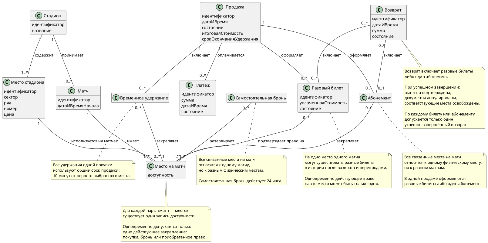

# Модель предметной области

## Исходный код

## Ссылка на редактор
https://www.plantuml.com/plantuml/uml/jLVFRXjb4B_lKtpA4RLHYpZrr2CN94Hv0JVUgXPn7CKRf0eXEJ4GK0AcKGySe80uSd6CDzuwwxNK9vZl5NWIVlFR7VnjDgmi49NghBzl_ipyvZSpwyV3f7EK7FVtesHmw9A1Upf8aa7VTNj7yLxI6nn4ptlTsFNZvFcWEoo_nFt3v0ME-a_Zes4KxUrtXaEt8x_wKvdAN38fPBNZEaFt9EbqUyTzzrday4yoNAQoWbZcly2tfKpnNFXHURs2za9c-5pXCeq-tvZ-KINz6Or-q4dsdczfSiwlK_b1Blq8WhcVo4yuEyFPZKphBb9_eheEVu94P5gc4dUIhPn27PVBy604htFBiP1SKhlvIktyKnnwuoI_dNeOoLmA5VPZMQjfFb-4rdv6seN28DUMI6S__lVeMOPqXSz9MQlAd1x97_W_W-Q4X2XmdLjabJPZMifh_0V0B0QiGE4tZGUtrtOIf68nQC24CNL-N9UNb1c-FzZlRjH-8QiGaZ-NDqwk87O3fLEAVjpR-oJUigu4-ORaOGYjAJO02ckYLY3xKguPn8UT5_tuO6js8OvSMT5Ue_OGlfShXTxmhD1uSlnqk7VKEzIsttGrZESRM_XCvSPVbFa3JnPpvIzeuQDu61zzsgaPk9H2snfoYBIIUdPyqFtF93GWMlAr0RJpSCVTluy_kxllx9Iz_8WgHY3bRaFw0QNPT12NDGGpsePJfL0KyIwqRlAL2ygcbEL9OBaXYN3MKX3RXH-h3lAPrAS0Fh-C8hPmpHGvhrPcieI5xrIINlNSP1ZYBQyBo2s9wnfw4-hSPP-DGeq2HK9n4979btSjNfZN7BMPLM3Fo-W8AHvdrR2xoxDr1rt_tO2PJXY3A8eE1abiYslmRECRp91N6gTJLj5neKDW3ICZV-xU_cx0kZz7hu2opTwtDr79CFzDTJGhI-8q4vQ4qAsrRFxYpa4isMwa0Roc0WPGVNvHHzPmSSBWhDvG90bmM4JE_54ybJSM2qgCo2IzLK5yalkFe4dKbum8zky5hUeu0pDZTC4RzV_IHcjGcTqeHgygmWsSbLpgw18fDAUndrZmn3oC9ejSW_38YEXU8R4C2hOce1dii4mpU_X0IvKXbJ5ro2IwdfNxnt7Q8oj6ih93A--q9IUIcSJ1Uu8b4EWMTaQRGMEgIgwd3AhE7Qq-vIuSOrh82l6bmJRovwe_8ohgXONH2YcNL0INuHpLs3BBEWqXQg5T2u-2WaEP1FVVGgIMEVExrd2LJEVC9w2hGLFdJBXKQZC2JriCes2Zj6jJRr6n8FEZibyR4mLFOKHtJhG6AKADWF0dG732g5TbGGEArUTsv4ZJQZHCRBGlDsJA_TXn_IqG_9bQaMLrR4Rz-5vPcmAQ8P7oW8QIb-M_h3TVm8_qLiRQU1oZpco2D0rwEfqOEAYAZEPpaBtr5j7ILrR7_nT1asw1gW5o9ddWrV3RzhN7-YdS4U--vxYgJ-gJfdpjCHOtTsjpUuSQBGnkw3N0fntY7WwHXc8R0IAt9GKWo9yTcUDkqn7rTLcWiiFv4e0ZhgfoeDCTTpiBttnVeF2KDPrNUuJ-oCoAFMCD3-ASjLfi5USxNb6PEgrDlQpEDgqrf0ecH9Tgeqf7Yk0DWamBe1dRFcsWWRl8RR7eDuX2l8vQ3RDoGVE7J7qT13HxZ2VydFyB
