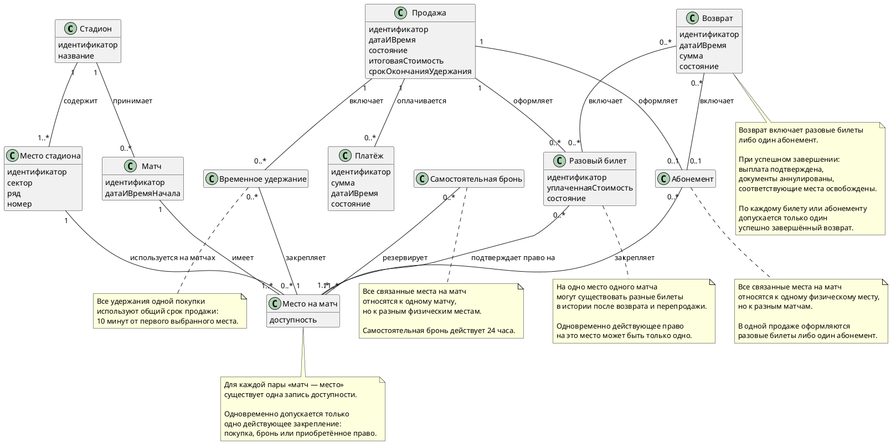

# Модель предметной области

## Исходный код

## Ссылка на редактор
https://www.plantuml.com/plantuml/uml/jLVDRYD54BxFKxHoHBlHBkAqfproGK8iB-34iuf574Vn16c5a9mOjA04p4Pxu02x88vS76F7iyvuBEqJLBy2Jy9NNq_7tPveP86856VSNJzLNtrLDNdQpredsMdtCCbwnoRhcRrUblMwfjqvIVUpJkyeEUYqKzDDiuDUk---fDtZx0MEkdlfIJz9zWzR_RxPaT_jkOnbAhcKijmnhRvvbhNQdTEk-Ien-94SbpDPGYott-3RGiPuBkt0NI-XFPS9FfUud2LVhqt_efBs9Or-qihs3xOqEUNNiVmiLtO0mSAEv5USlSJPhOnZ5pDxfhe6Vu94PEnIILlPLawXZij5U320rwdFiPG2dWRtkrPtHehDR4FdKobLs0vb1MdtV1bQUujCIyrSRdpihSFqtmFcaw8hV8vSUIfpUYH_uNS2pH4vKEAwy95Lsenf8M_m2qo9Fwn0uG-D1xSt_YH8nSUW0HEvcR73M5vcpF3Ztc5xhVORYOIGx8MyCt8DiLiedLFqyyx-5-cMfIJ8j-GBGsXAiGvGM1Er0jbNSiCWFcszwAP7MnCASHJAYkOQDOVmarmhz1xF2erdftlz_PFECJlzhf5Xl5ZRmkTCRksbonzusW6BU4aBdwNzzEJBLcJWIahjPCWXqahg-UbH-p-Jq0FHaA-VEJkFTyp3X_Ypk_l1ZclV9rJn15BkrgGVKPfD1t5PGJ2dRJXL2YK9xqBhNhvoGTaPPNaIMuub4SvAIc8xjqFLGJwZU0hWyziaOGj7fiXvjJAH1Ipyg9BqgkTUXY5kU9r3Ra5SLz0RKUS--smKQfGeKWcDuaxUtJLuOLvJr6PIWJrrqJb8npXsm-u-pxuxwFgk0NETC1wY93dgPQdVLRtdQzzWXhpME8soYevB7G8h61dO2_F-Jm-i-Nlm6YZxsVl-Dd4CizzNHnDN4gEPi2I4RgLbivVt3cB9TnCDu0qLC83Y-KKTMS756OFpzOOYIQ33KTNfZ-BGVETZGOaHcSmsAeXFSly9D8dwWX71_eEWLGrdOEuPNV96_R_oepMep6wIebSLuKsSIJfrT8KKwjFOZdpmn3oC9eTMJ7XcH7IlaLWE1Ryce1dii5mpU_n8IvKZbI5ro2IwdhZzOpZjaHKZMVf3NzvnGquaCuc3LmEVGA1RyipR31fJLGezPL0nTxJwbBiqZ6cEq2za5cmZUw7w4wAYNbWOhP1oIKLm6SvHZIttMSz2Y1fery2ZeE1G9i7j3n29CcT-Dngkakc2-GHqzT34d0cNIZGZyBJ5C0esIhCszUOL2t8xSFrQcoXu2YEwTwBLI15g18G_0u8ZHhrq1Gqe5i_jn92crMWO-T6-M9Efi4F3zJUNNDymE1NSiJTgXmzSRKfeXaGg0XfAuSf_5JTVm8_PHiQWW1kZnji4QMhqD3enSE2AhCrdPBpv5j7GLxwE_o-2Nhe1gXh8MD61Lu_Vjgyz6_t4vlZm8yDLVHPF6lVQ4x8utgtrxHrgD32ufbS3dtQ8UpX4QefD14ZCbXHGmRSwlmntcuwexro1N8Vp9G17N5LkeDCTTpiBNtzVeF2ODPrMUuJ-oCoAFKCD3-ASjLfi5USxNbcPEe-cNXwpJMlD6Qi9qQNQgDAHCdY38DC2Q8P-dzRGm5rYjbZqQqGX7gCMOUOMDF-HYTT1GBEdUC9_yFy0
