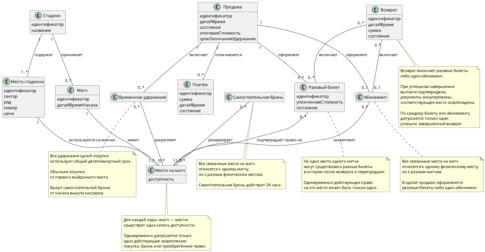

# Модель предметной области

## Исходный код

## Ссылка на редактор
https://www.plantuml.com/plantuml/uml/jLRDRYD54BxFKxHoHBiH84vxsYCN9CJo0auygrZ4SHHFa5O8AOc1W188H7lW0BiWZbmSuubd9vEnj4zGymey2LzzqxtJqpOZ2xGvTCRTzLFrrLVL_NYSz8wIu-5-b8mEJJ8oEwCa6GrDVt0KxoQ3qK6qD-Z7PXWdUwF-kFuH3m-JPzWQxiH7uoZQtU-DnsPBVg_EP2fpoQIK-otJ6vidIQy_E1wQBoA3FybmcCeznBBgA_pAPOhliZgfZ--XlP0PrdiSfj6NZUbVLB8wfz6FUidkteOcv_mvbP_bkZg1O55ToQ_OEyVUdKpRBjBgL7MD_ciIaMcTIjnBDd8ATHpc_iO9lCvTZgKKahgJRzJElyMX9qQAC7K_ahcKAbnDPAcc-NtfMtk9j4k5GMvT8htz-B-ZvpAaAwnNjbQrETsIlwJK8k982L7Yk72HMMt6bCiBoHLW5WDMeF27neFJMxVZfs9Zq809OsggILjUKcRuuMY_twZzHbOXfEf2NXcvWTWTbCue-kbWzxDumxeIv3kIXo5qfXW2rAg9Me7iJtBB83xkFHl61nkp2t4Koehk6dM7yAFSaDiMJul6a-ETyUxHu53Rlkbg62yQMrXJkQikw_o1fnOJ5YvfuPDu71zztciPk9PIsnfoYDHAFJq-wFzl4ZeWEl9r0sZhlItpy27-RM-_irNtyYEgE08fTrUatwKqcmxYieHWHjjmgXIA8fu5rhbdNL0sfIntGik-9C9PIabi5zL4TP3FLNiAOFqwYjZ2BLFal5gPIGuBFwWalNBVoZ34mEi2SZbnNKBlYZhhxBDHg56YI2KqYZVozLc75-OrHsrc5knv7HqXnUVC3hkrdcrtqFMR1inqmZY8ekXWbCJkuXezRNo36V9SupJAAZekTGWiOUIakZ2l_tJ0chzFdWDbDtjVtqKrmwhlxDQiBedHJ5WIGhVKibMNQmUnPDkH1l222XX0xVb57Ld2nIc3S_M68acWmr7LwO_Yq7pbOa694PcaGGMnalkFe4dKSqO4-m-yLZMSWPbZTCcJb1F9ZTQcCjjHZ5vLX4ESIJfrT8qKLgUneixWYNahcYmo0U6P4T6zGM8P56WCW2YGKcZZGUOCguvnTuTOXA5q0LPm90Lv4ucIN6Dmi_g6ChmFDEyfS-PcGu1fRVWQChG4X-l7eCtEOIjPu---UMVGcurfIYx2pgbaL2ew46PhaSPujJHSQ8ZAFJz-EoPKfT1T1IrWidAHSfU6-Iy8QkhTZTM5wizO8-OBcf0l2e2AuD2VwXeRZzEQYCsZewi9EbZTq0_ARBVgUuYqCcT-jsnArf_vDCtJGEFZwrznhOc5hmr6etU_TMjJRs4PXphNqsDblk7BZsZzV0r9uMiqxOTb1eK52Ss2UdHktoAMedPGNRcB9c_8L5GJmyjuWU3FrOhaTjiPhIOFr0wBcFj4AZmQAhaPOdiKUFn8Wunr372e6skJf0dfQNH-OSCM6SF1o3HyqtJqbQtZMqRGINT05OAiiwxnwl3R-14Mz1ERu_qFZ9P29vYFY7s4aSNhR_hmBU5hT34uq5i5dtQ8kpz4LXIx212P3IcWWYzrVXczQJcYlgqBL7SudoJOgYzEZc-wuqk3XLzzlL1uofhExLr3VsIcPSz4muCuPwqMMyNvuYojgRFMrCi2jg7MdB6Q45sg3PkEbCrxXappePcuspr4GyyYiy6peq4qCW5gBSpuNE1z75m77iqUu-jukFyF
