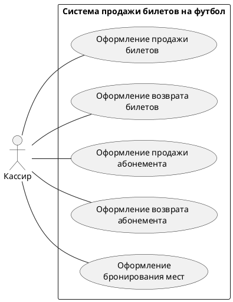

# Диаграмма прецедентов

## Исходный код

## Ссылка на редактор

https://www.plantuml.com/plantuml/uml/dP8nJiCm58Ptd-AfU-zGYHkqZ2mcDQr5I97ji22a5hgpCo1n0pUY4AbjkCBl6_5iTGX4eAXP4Z__xylltszadJIklCb5hguSkGKPFPixccgZCgSNXH0oSmj30xp0XrLOeGxB0KbBPzBEjJ92HAKiPhbYqHjg5ZrYYpqyuIiiqU0T7X-e2HlKs67B-mqgme4bOHsUUBtXocv0zuBuAQtAf8surx16munzR6DzZUqlw4NnavgidUliMhc9p5KVNiLzdwYux9dX_o6EbIjDSOf7dqvuIBcmAFudSIVbfSsClerHd-Yt9xslztZyP9vNwLt1f-zdYlHukuazLbQPEndHua68upJGSDXAlrizkcZLEmdyiTVjR3iOgMBAK_mD
