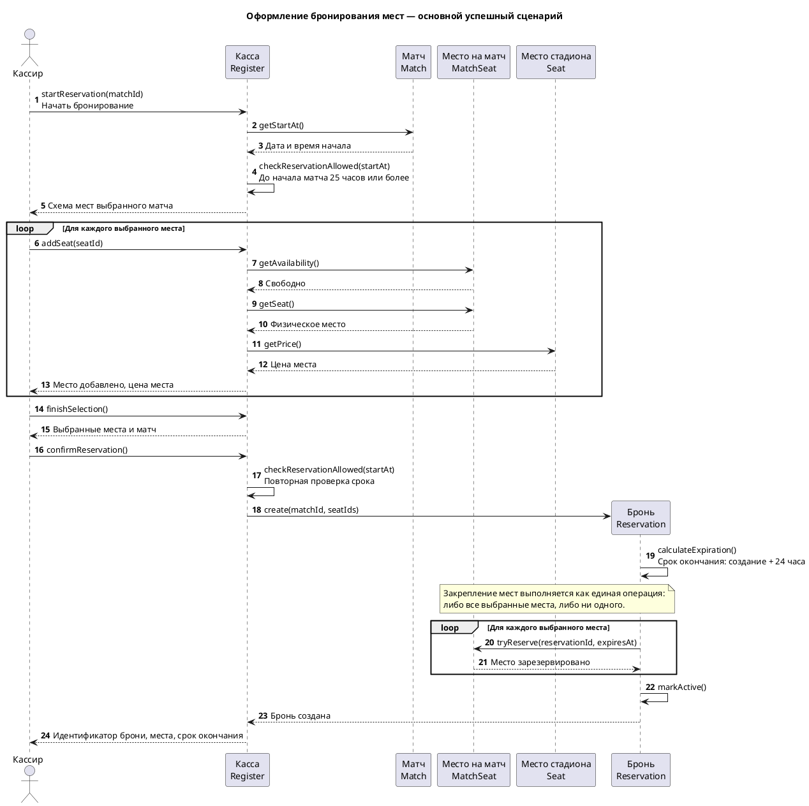

# Диаграмма последовательности оформления бронирования мест

## Бронирование мест

## Исходный код

## Ссылка на редактор

https://www.plantuml.com/plantuml/uml/fLRBRjD05DtxAqPT9I9bKS6c2zG8iM21XEYs6zUPjbOTExATG7TDUGIfbIfG9H3YeKg8jHjgcZxY_CBu5_WIpfsndN4IbqMpY6V6ztNkFVUEruBGzCDksp52EtGu4z_JDo99zyMDk1Qn68kHY9aumq526_aSYaYkZncauhIV7h2_-oSCQdsSqtlwlsJfQnnC8F5UZDD3EkYdxwJH27P6uj8mkw7dTjkRt3SCqmezdos9BtZRXo9yBJ4pO8_DOCU6G0TnsfRTCTrGauest1Tysmv2xalfV3CZ_XNY1-bWmtrcXjQEb9IhEJ49HoICWYHukjewDyEfAkqgrUKZ4kT0INb3b8No0hqFAhtf4O49kDypGzjpCpp5tZ2oLB3bHmLEjifa1JMvMfl2UzggRxZY6m0C98YZYYgAs2XimQw41gFRF5mdkysmLZVKuNBPhJWXkvIb4HD3c8p53L5Yh5o2Fb79igPgxN1hLukuwJZUIzwg1SeZ1NwIrI0tLTG2ovM7J8Bg4mguntk4S8OTKLR70xTvpX3mQVgMWbJ656yH-A7C2-M2MFkR_1Qk3CFnl0v1lIPeLn3xWw9cOXMwYWEHmV1RN36prI8Mr0ByeKvISgu89A4AqUoPjcDkseuTxjMKz5HYjYgdA6mYat5EGVtFjepZVpP_8iSNeCs0i24B2Ss47EYyYwdrvxvjySpyGik_r3YOJLjL1RN-F9Se8w1LSoffi7ouwDQuswhgcotRjGC0ThWbswPUIPoFUg6nrj0h-cU4gV9aUUwMxRVr7gtVeJT-4Eyf2mY9MWJCd6Gj7UC9bjByeGCi3Sj7udbfa9HT5-VaNGhd4wJ154C3YdOgDgzbEbRNWUAJLntRpm0Yq5CL19EHq80Rv3V7AfFTUu4oPbE8tMCh3_A-HkEv7eBsUWXIyzNGHYzZuXEKh-JacUYtLQcv9t8iZDDZ71xWE6jZ11NByPmbC94N5KeC4b5yP1vZXHg9xFJ9xl0M6ZGqyJ5H8ki_6WhtYOMC0DrvdioKGM_cqDzJRtdDdqfH4JbLXGSWpy8-rokfTzY5lAPZF2anmzAraQZ6kfKLRTFVRQArUhmsmv-P8L1SVsLIH9Nz-1aIg3R27E5hPKHvLEsWtN6DKd7oVbX0HMCDKEW3w1y
