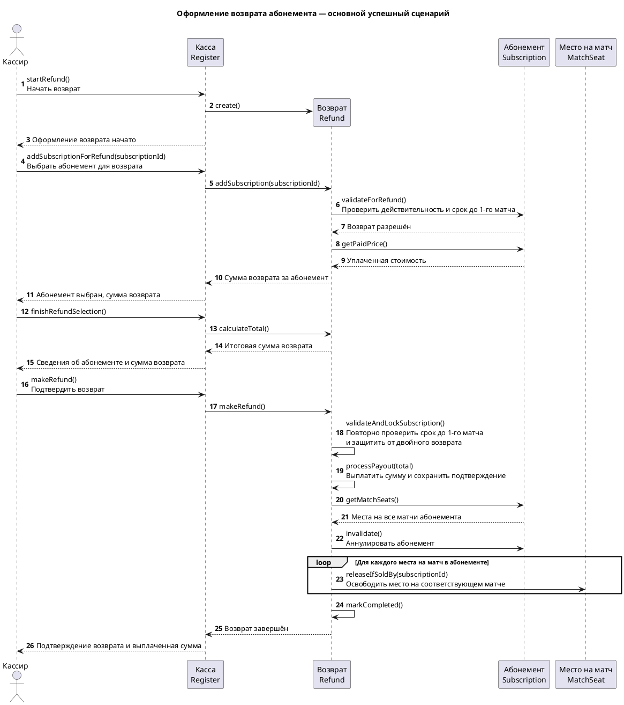

# Диаграмма последовательности оформления возврата абонемента

## Возврат абонемента

## Исходный код

## Ссылка на редактор

https://www.plantuml.com/plantuml/png/dLNDJjj04BxxALQSG2g7NZbKj4YLa5e9DJroMMm35euTsUjAt0XfIwkYGX67gcf1g2yGGb8SafXNc7s5FabdThF6CJQjoY4au_dvPhvlniknu958chubFE6x3CxaMyZa7enX10EOG0e31Zt8u1fwQExAVUWowC8bcYReCIOlPVozTyemj8tc32FeSyXa1mstC90VqEiJ6TholKhSnMmf32sUY318cXjkP5dS5c74vk0RFcrZO2htvXYFsGgFjprqQ25Mp_PQF105h-vwyChTycBXHihR_2YvdnIRe93D972c0VIrv7vSQX536ib6R4TUItXXe0ABXbBuT-ovZNF96FNAO4nLvS5wy98BUxlXSg4ovByiQzeaMtoITy2McE970vnVM0_W1-OvKBaEIxnOTeHvNDEDoO7vfYRCfbtc5mfFyR6flFIlz4yC2CZgS7F7AKxdUHXDcuWBrbM7MZf1OLnIScggGbiC-Z2IH_TmLBPOBbokPqqTCQJeXe5lkEyvE9qxg0Jk7AkHd0SaLmsmZx26YjmUcM20w0v9xsGZXvHKJc4tv9onnujm1Lck0KG-Ktgn27zMfep-mJL-uWR9Bp2fXx_bYZNkEMkHPoF13rNuYGiv8WOLmyJb4TDQHRh7fesyqYolS24xw8IjLEZYkl8sr8dj_efXIgC5c3n2KBMrwcItwGLUlAsXDrpVjPK65cgsWVjsuYFbhqF1VVIgQVchciqLwS0CgnPNNQyNf27ewwN271XsMJ4hMhVqVnflyXstA5kCwgE_5cuVqeg3KJsKOY8paE9pioPF0-T5QEyKTPPNxj70iCY4L7zRtg2_RGScIPMMv4SACDWpVGceXI5bfgYA-Tz7t8f2sutZDRuR9c9U4DVcxEX5C2NCs6L7au0btsaj6WotCsFzPVY4mODxcH_v-E75DEyCVM6nDuGmk1jCMldUhQ_i1OOhHSmnBJisE89KCr9xS2tB3yCMWrDzTc_GWrhD34ypA0qyX5kfPulXtnt6V1O8CC85vR6xkja8VUVPRiMhuKos5SEKDHVnUFRLIZn1DYLbNzzbsP6VKJq88yU7IDp0iQe4qkJHpahORFckS9twCp1xcKcWMWVwCjTk_dcTPYeEQAekOELzDXV1MiOsagR_1m00
