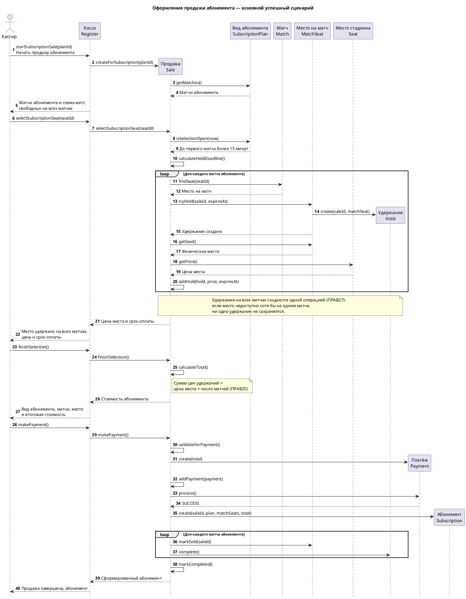

# Диаграмма последовательности оформления продажи абонемента

## Продажа абонемента

### Исходный код

### Ссылка на редактор

https://www.plantuml.com/plantuml/uml/hLVBQjnM6DxhAGvPpS2aq48e15fIt9PcKMewxMusykZO8wAHX7GcJNRsk1CN798s10gbjz3IjUnuad4y7Y_w0aUlq2Vfz_-wtnmAdOL6EkVxB-VxRzATK9c1caqTGzdAaKB_6d-hD_6-NkiBlTINUgMNGbzXOQFFTAHVwPN0tmaUBx6_9amyrv7uP_-vWE01bZVwbA_d8Zx4mfLUnjy1TKmB1_4ZLXj1uqgV6-PCUUvikYC3Os9RKknwdjhn7XY6ELPU86xedm0zW9PLl7z3cA7OCiE93RGFj-snxPkkAg6YaVkbtBD39GD6Pmyr-6-byq1aQ3gIuNHJWpw3csUjHuRSR2SS1xQlRC_TTaoNTT1DJSVFy6uU7utSpqqrdZ2Axngm9Gunrnj110bOAeiDfQaAKNhg5EU_2ETRiS_aQIRS8lS7W4iG0YgIU8_Sppp7OZZTrBb3Of1VF-XN8tVRV3YLRg8wlQ_1lwyJLwKjSQgqO1XfXCND3_FmYTk2yxGCf5ZrV91zr-gFNFqBd3fYnnvNyZK-R0sUCGx0X4mYdfk1ILg0kMJxKoyecypC6Gm2c68Dy9vK71GPzle6hzqiD6NHxoYSad78P6T_gvZ0EiAyu3NE5Gx-OEIY2aw1Fc42K7Nn8asdK-miwIdDArmNdMnBHuwhT8EFNeWBdR-5iBT8r2cpmo4B0FU5BzsUwttJGjrpgeKhpauwqqjwpBqNV4RgKalnxYtQME6yX_4yjvN5qdJ6CmVXf6p-M9gMOxiIaJ8Sp_F9o4NyLEWtt0tEMioqHKtWbvdXsCFEhkrQbKCJADcivaDhcHjDdQGC4YfuI9xtGkpTjGP2Fl3jG8OVgSH2cibSghb55eKUMitJETSmpI3zkaJ9pqPVGCA1XzTSL-ZltGwZ7fY7wxJ_2OslqTMFY0sGlw4viywegQWkj6u7zbYcQXiQ_qe6Iw4bgdgOuapBOZOdk0o4Jnehb4hNCWpN0wFUVMGuIGqoSkkSKDvqrbQ9hlW95Wy8pKN9in6N9BCZZ4ImYwKUckllw9ZFtdk_VvlC4JKNr07MvPnPKfRIOtm85PVKy1TOc9F-a_WuTIcpj2wSMWv8wIKfJ7SneHjH9WliUxmWxv3mJu5W_zyXTWIHanLqjMsqn21jLDIFtoHdJiR7yJMDBvzZLUSsrv1DZUzHPhpBOaUpGztQuIJlHxtM_jO4TNMPhpnbEjZd70hilOaItcuoQC3-2nngpJqxyRSPWNFn0O35QGeg__vHq43Wf2Yrg6hgtEeNGMgDqGlY5dRMQH8z_czpgVk5Q52uj1gKSXRJ6HctOhCl-UqmGgecUsK_kk8pDU_9zEMYFJPLG2qkzqt7jf9PNc2oyP-zi-JJANakEgQYO3PqeeTaklpalz-YmW-yiGpvdI1TAxMhuTTRMvyCXxadbNUWt5nfiTd5wMsarCl3WKYz_Ly7MzfzfsPmRrXCeNu5c4qPR-exKb67vYvQOurKRAKGAmzK8pkpxuyLb_0fLqNozT1qk3DBAs_u0bquWYPK6Rv4kAm6RSgCEt2RleN-1G
